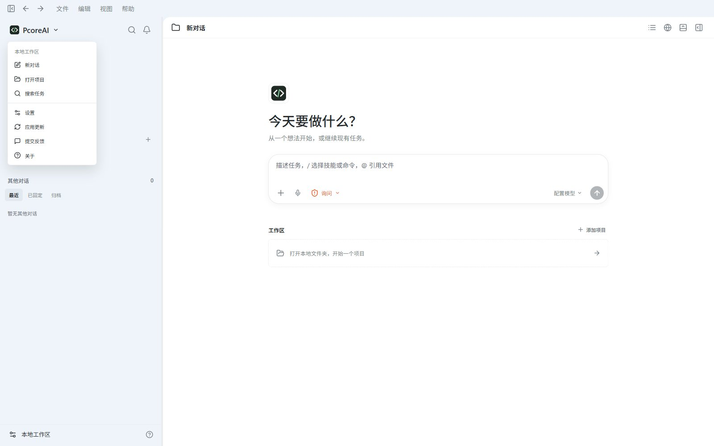
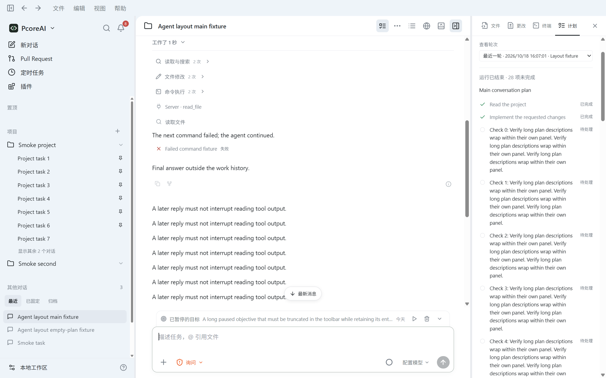
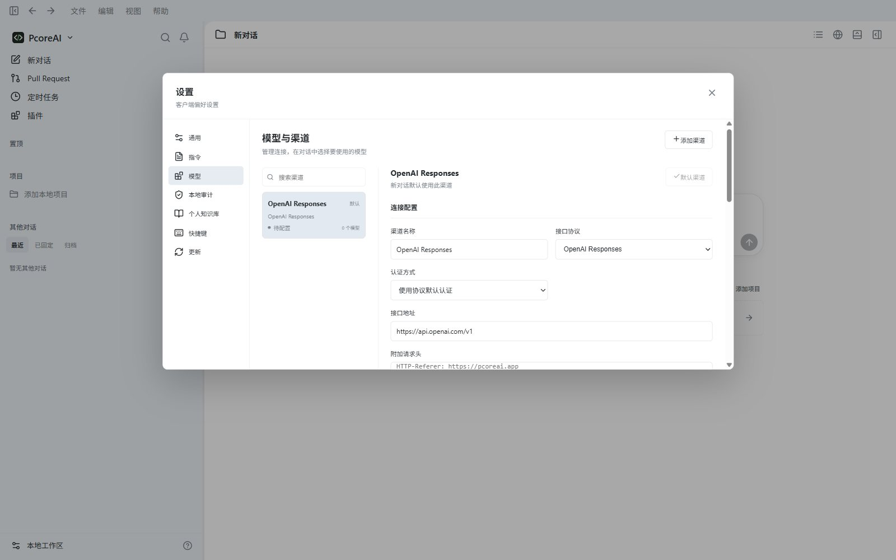
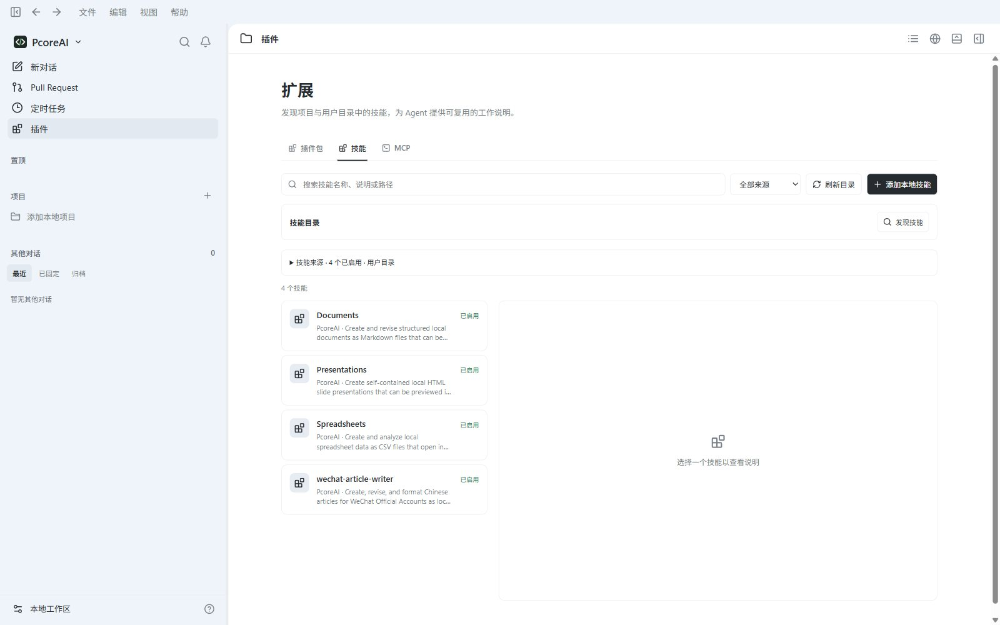
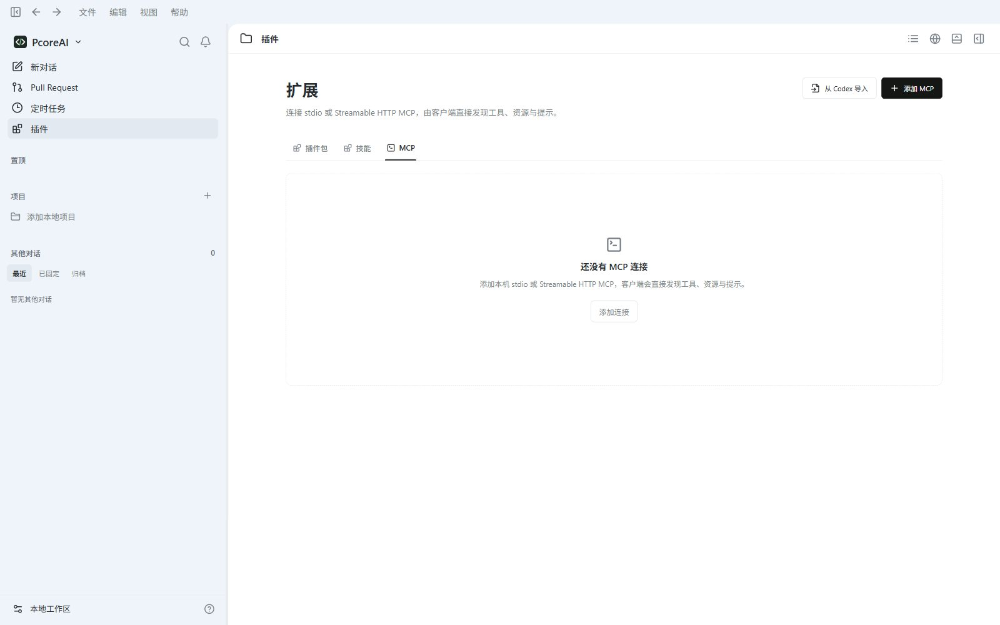
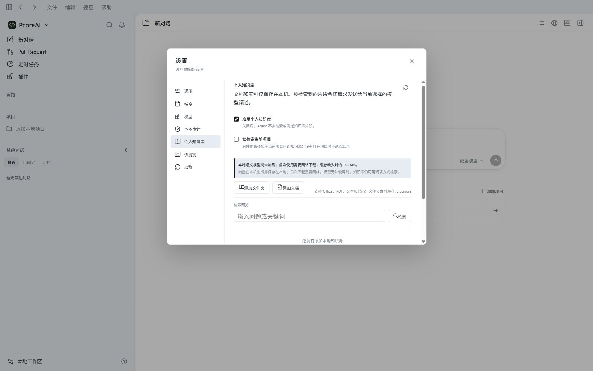
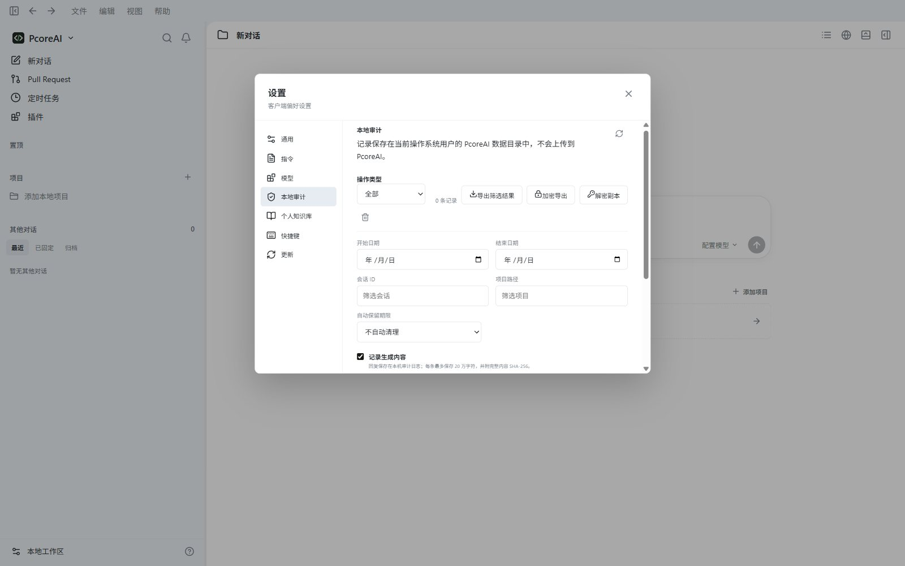
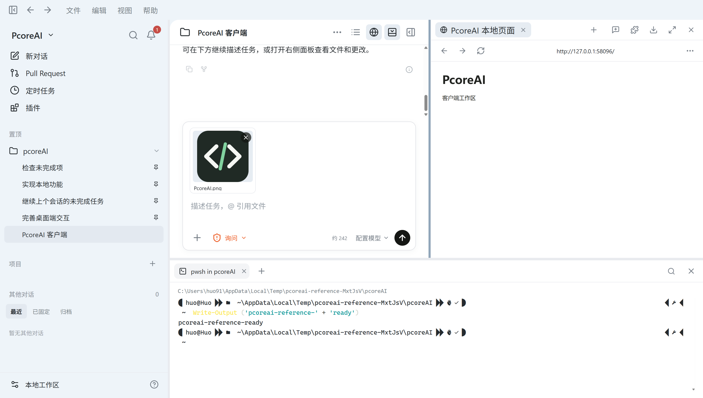
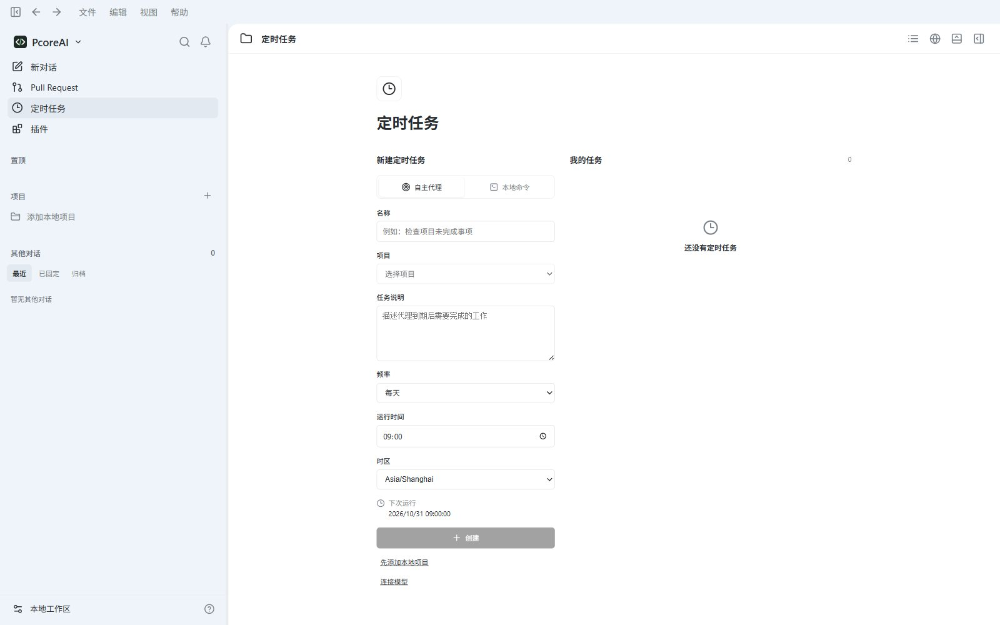

# PcoreAI

  

  <strong>把 AI 放进你的工作流，也把工作流留在你的电脑上。</strong>

  PcoreAI 是一款面向所有人的本地 AI Agent 桌面应用：可以聊天、写代码、运行命令、处理文件、创作内容，也可以接入你自己的模型渠道。

  <a href="https://pcore.ai">官网</a> ·
  <a href="https://github.com/mszlu521/PcoreAI-Releases/releases">下载最新版</a> ·
  <a href="https://pcore.ai">模型服务</a>

本仓库是 **PcoreAI 官方安装包与版本发布仓库**，提供产品介绍、版本说明、安装包下载和问题反馈。

> 以下截图用于展示主要工作流，部分来自较早版本；界面以当前安装版本为准。

## 为什么是 PcoreAI

很多 AI 工具只能聊天，很多开发工具又只服务于程序员。PcoreAI 把对话、Agent、本地文件、终端、浏览器和创作工具放进同一个桌面工作台，让不同的人都能从一句自然语言开始完成实际工作。

- **对普通用户**：写文章、整理资料、处理文档、生成图片、制作内容。
- **对开发者**：理解项目、修改代码、运行命令、查看差异、使用 Git、预览网页。
- **对专业用户**：连接多种模型和渠道，安装技能与插件，挂载本地知识库，保留可追溯的本地操作记录。

PcoreAI 不要求自建服务端或注册账号。应用、会话、项目数据和工具执行都在本机完成；模型请求会发送到你在设置中选择的 API 渠道。

## 核心能力

### 1. 真正可执行的 Agent

PcoreAI 不把 Agent 过程隐藏在黑箱里。模型需要执行操作时，界面会显示正在执行的命令、参数、实时输出、结果和文件变更，用户可以随时停止、继续或查看详情。

- 流式对话和多轮上下文
- 计划、执行、结果和后续修改的完整时间线
- 本地命令、文件读写、目录检索、Git 操作
- 工具调用自动折叠，保持对话清晰；需要时可以展开查看
- 停止、取消、恢复、重试和失败后的继续对话
- 上下文窗口默认 272K，在接近 80% 时自动压缩

### 2. 面向项目的编程工作流

把一个本地目录加入项目，PcoreAI 就能围绕真实代码工作，而不是只对着复制粘贴的片段回答。

- 项目文件树、快速打开、文件搜索和 `@` 文件引用
- 代码编辑、语法高亮、保存和本地预览
- HTML 文件直接以浏览器预览
- Git 状态、差异查看、分支和提交辅助
- 内置终端，命令和输出可回看
- 文件变更悬停预览，延迟触发并自动选择合适的展示位置
- 适合修复 Bug、重构代码、生成脚本、搭建网页和分析项目

### 3. 多模型、多渠道、多媒体

模型管理独立于通用设置，用户可以同时保存多条渠道，并按模型能力选择适合的配置。

| 模型类型 | 支持方式 |
| --- | --- |
| 文本模型 | OpenAI Responses、OpenAI Chat Completions、Anthropic Messages、Gemini Generate Content |
| 图片模型 | OpenAI Images、Gemini 原生图片接口及兼容渠道 |
| 视频模型 | `/v1/videos` 创建任务，`/v1/videos/{task_id}` 查询，`/content` 获取内容 |
| 音乐模型 | `/v1/music` 创建任务，`/v1/music/{task_id}` 查询结果 |

可以为每个渠道配置地址、密钥、模型、上下文窗口、输出上限、推理设置和能力类型。应用内置 PcoreAI 默认渠道入口，也支持替换为 OpenAI、Anthropic、Google、DeepSeek、智谱、Kimi 以及其他兼容服务。

### 4. 文档、内容和创作

PcoreAI 可以从对话直接进入可编辑的内容工作流。

- Markdown 文档创建、编辑和右侧预览
- 主题切换、代码高亮和一键复制
- 微信公众号、掘金等平台的内容排版流程
- 通过技能生成文章、脚本、方案和其他结构化内容
- Word、Excel、PowerPoint、PDF 等常见文件的本地处理
- 图片、视频和音乐生成结果可以保存为本地文件并在会话中预览

### 5. 技能、插件与 MCP

PcoreAI 把可复用的工作方法做成技能，把外部工具接入做成插件或 MCP 服务。

- 使用 `/` 触发命令、技能和工作流
- 安装和启用本地技能包
- 插件可以提供命令、Agent、界面入口和资源
- MCP 工具、MCP Apps 和交互式表单
- 工具权限、请求确认和本地数据范围可见可控
- 可为不同 Agent 指定模型和工具权限

### 6. 网络检索与本地知识库

PcoreAI 提供基于内置浏览器的网络搜索工具，也可使用支持原生搜索的模型渠道，在 Agent 流程中检索网页并查看来源。本地知识库可以导入文件或目录，在本机生成索引和语义向量；使用远程模型时，命中的相关片段和路径会随对话发送给当前渠道。

- 支持 PDF、Word、Markdown、文本等资料
- 项目级知识库和个人知识库
- 本地索引、检索来源和引用片段
- 文件来源可追溯，点击即可打开原文

### 7. 本地审计与数据控制

PcoreAI 面向个人使用时保持轻量，同时为需要追溯的工作保留本地记录。

- 当前本机用户发起操作的时间、任务和结果
- 使用了哪个项目、文件、模型和工具
- 命令、结果、文件变更和失败原因
- 会话历史可以按需删除，减少无用上下文
- 审计记录支持筛选、本地查看和加密导出
- API 密钥保存在本机配置中，不写入对话内容

### 8. 浏览器与自动化任务

- 在工作台内打开网页、查看内容和预览本地 HTML
- 浏览器、文件和终端可以与对话并排使用
- 配置定时 Agent 任务或本地命令任务，查看运行历史和结果
- 定时任务由本机应用调度，需要电脑和应用保持运行

## 安装与开始使用

### Windows

从 [Releases](https://github.com/mszlu521/PcoreAI-Releases/releases) 下载最新的 `PcoreAI-*-win-x64.exe`，运行安装程序即可。安装后会创建开始菜单和桌面入口，后续运行更高版本安装包可以直接升级。

当前已构建版本：**PcoreAI 1.0.2（Windows x64）**。可下载版本及更新说明以 Releases 页面为准。

### 第一次启动

1. 打开 **设置 → 模型**。
2. 选择已有渠道，或添加自己的模型渠道。
3. 填写 API 地址、密钥和模型名称。
4. 新建会话，输入问题；需要使用项目时先添加本地项目。

PcoreAI 默认提供 PcoreAI 渠道入口，地址为 `https://pcore.ai/v1`，API 密钥需要由用户自行填写。你也可以完全使用其他兼容服务。

## 隐私说明

PcoreAI 是本地优先的桌面应用：配置、项目、会话、知识库、审计记录和生成文件默认保存在本机，不要求 PcoreAI 账户。

发送消息或让模型读取项目内容时，相关内容会发送给当前配置的模型渠道。网络检索和浏览器功能还会访问对应的搜索服务及网页。请按自己的数据要求选择服务，并只把允许发送的内容交给模型。

## 下载与发布

- [官网](https://pcore.ai)
- [GitHub Releases](https://github.com/mszlu521/PcoreAI-Releases/releases)
- 安装包同时提供 SHA256 校验文件

## 反馈与建议

欢迎通过 [GitHub Issues](https://github.com/mszlu521/PcoreAI-Releases/issues) 反馈问题、提出功能建议，或在 [pcore.ai](https://pcore.ai) 了解模型服务和最新版本。

## 许可证

本仓库用于分发安装包和产品资料，不包含应用源码。发行包中的第三方组件遵循各自许可条款，相关许可证随应用附带。
